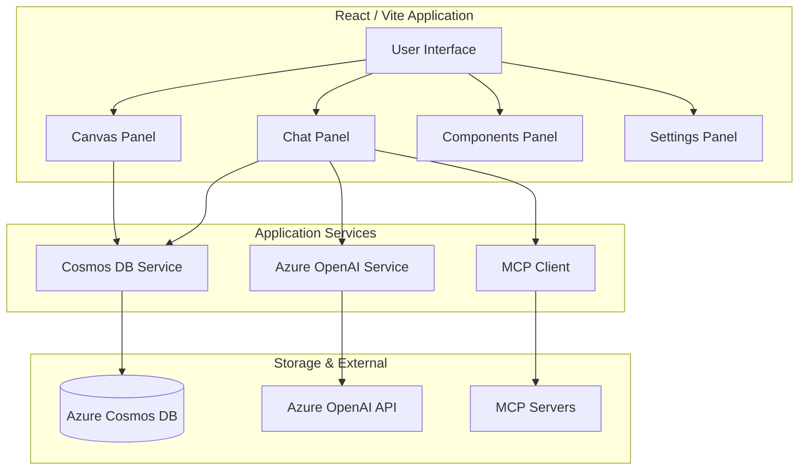

# Document Analysis Assistant

A powerful, dual-pane AI assistant designed for deep document analysis, interactive data exploration, and multi-agent collaboration.

## Overview

The Document Analysis Assistant provides a sophisticated interface where users can interact with multiple AI agents to analyze complex documents. It features a side-by-side view with a chat interface for agent interaction and a canvas for visualizing insights, charts, and structured data.

Entirely developed using natural language prompting and engineering through **Google AI Studio** and **Google Antigravity**, this project is an example of the power of "vibe coding." Leveraging advanced AI orchestration, this project demonstrated that intuitive, high-level intent, when well-implemented through agentic workflows, can produce professional, reliable, and highly functional software implementations.

## Features

### Interactive Canvas & Insight Management
The Canvas Panel is the core of the document's life cycle. It doesn't just display model replies; it allows for active management of insights.
- **Dynamic Integration**: Add model replies directly to the canvas to build a persistent document.
- **Organization**: Sort and reorder canvas items to structure your analysis logically.
- **Direct Editing**: Refine and edit the content of any item on the canvas to ensure accuracy.
- **Markdown Export**: Once your analysis is complete, export the entire canvas as a clean, formatted Markdown file for external use.

### MCP Integration & Tool Orchestration
Leverage the **Model Context Protocol (MCP)** to connect the assistant with an evolving ecosystem of external tools. 
- **Granular Control**: Users can selectively enable or disable individual tools from connected MCP servers, ensuring the agents have exactly the capabilities needed for the task at hand.
- **Transparent Data**: All tool outputs, including raw JSON data, can be optionally added to the document analysis. To maintain a clean workspace, these technical details are initially collapsed by default, allowing for deep-dive debugging or data verification only when necessary.

### Comprehensive Document Management
The system supports full document lifecycle management. 
- **Document Upload**: Easily upload local files to the assistant for analysis.
- **Cloud-Native Storage**: Powered by **Azure Cosmos DB**, the app ensures that your documents, analysis progress, and chat histories are securely stored and easily retrievable across sessions.
- **Interactive Previews**: High-fidelity Markdown rendering ensures that both chat interactions and document displays are rich and readable.

## Architecture Diagram



## Tech Stack

- **Framework**: React 19 with TypeScript
- **Build Tool**: Vite
- **AI Engine**: Azure OpenAI (@google/genai also available)
- **Database**: Azure Cosmos DB
- **Styling**: Vanilla CSS (Modern design patterns)
- **Icons**: Lucide React
- **Visualization**: Recharts
- **Markdown**: Marked

## Getting Started

### Prerequisites

- Node.js installed
- Azure OpenAI instance and API key
- Azure Cosmos DB instance

### Configuration

1. Create a `.env.local` file in the root directory.
2. Add the following environment variables:
   ```env
   AZURE_OPENAI_API_KEY=your_api_key
   AZURE_OPENAI_ENDPOINT=your_endpoint
   AZURE_OPENAI_DEPLOYMENT=your_deployment_name
   AZURE_COSMOS_ENDPOINT=your_cosmos_endpoint
   AZURE_COSMOS_KEY=your_cosmos_key
   ```

### Installation

1. Install dependencies:
   ```bash
   npm install
   ```

2. Run the development server:
   ```bash
   npm run dev
   ```

## Feature Plans Roadmap

Continuously improving the Document Analysis Assistant. Key priorities on our development roadmap include:

- **Enhanced Testing & Reliability**: Implementation of comprehensive unit and integration tests to ensure long-term stability.
- **Advanced Export Options**: Expanding canvas export capabilities to include PDF, Word (DOCX), and structured CSV/JSON formats.
- **Prompt Library**: A built-in repository for saving, organizing, and versioning reusable prompts to optimize agent interactions.
- **UI/UX Polishing**: Implementation of dark mode auto-detection, improved accessibility (a11y), and refined micro-animations.
- **Expanded Agent Capabilities**: Integrating more specialized tools and improving agent logic for more complex multidisciplinary tasks.

### Copyright and Ownership

All terms used are copyright to their original authors.